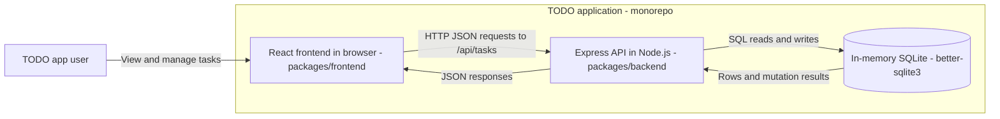
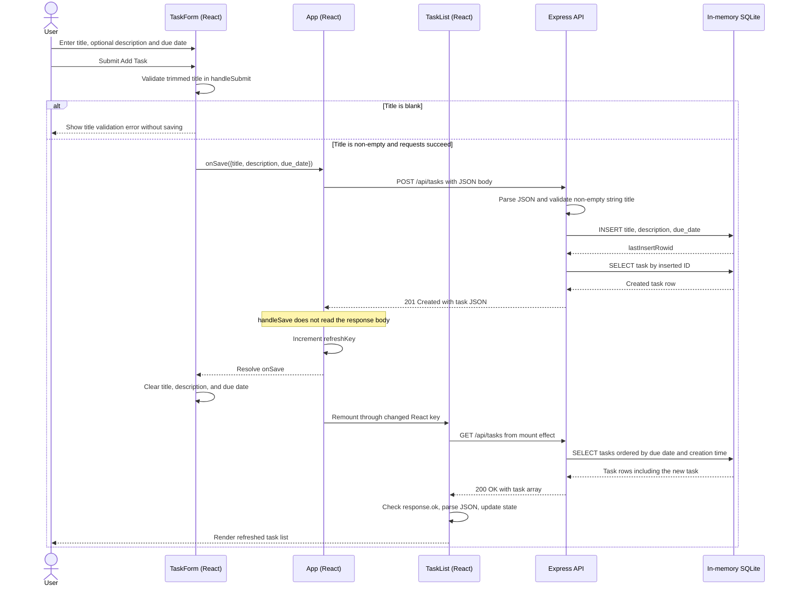

# Architecture Overview

## Scope

This document describes the current monorepo implementation: a React frontend, an Express API, and an in-memory SQLite store. It does not prescribe a cloud provider or deployment platform.

The local-storage-only upgrade in the [PRD](prd-todo.md) and [epics and stories](epics-and-stories.md) is planned work, not the architecture shown here. The current frontend uses `due_date`, not the proposed `dueDate`, and does not yet support priority.

## System Context

- The frontend renders the task form and list, and calls the API to create, read, edit, complete, and delete tasks.
- During development, the React dev server proxies API requests to `http://localhost:3030`, as configured in [packages/frontend/package.json](../packages/frontend/package.json). The proxy is transport plumbing, omitted from the logical diagram.
- [packages/backend/src/index.js](../packages/backend/src/index.js) starts Express on `PORT`, defaulting to `3030`.
- [packages/backend/src/app.js](../packages/backend/src/app.js) owns the routes and creates the store using `new Database(':memory:')`. SQLite is embedded in the API process, not a separately deployed database service.
- Tasks survive browser reloads while the API process remains running, but are lost when that process restarts. Separate API processes do not share this store. The browser has no direct database access.

## Creating a TODO

The sequence below shows the frontend title-validation branch and the successful creation path. HTTP messages follow the development proxy route described above.

### Implementation References

- [packages/frontend/src/TaskForm.js](../packages/frontend/src/TaskForm.js): `handleSubmit` checks `title.trim()`, calls `onSave`, then resets the fields. The required title input also provides native browser validation.
- [packages/frontend/src/App.js](../packages/frontend/src/App.js): `handleSave` uses POST when no task is being edited, then increments `refreshKey`. The updated key remounts TaskList. Form reset and list remount are consequences of the same save completion; their exact rendering order is React-managed.
- [packages/backend/src/app.js](../packages/backend/src/app.js): POST validates the title, inserts the task, reads it back using the inserted ID, and returns HTTP 201. SQLite supplies the ID, `completed = 0`, and `created_at`; absent description and date become an empty string and null respectively. GET orders by `due_date IS NULL`, `due_date ASC`, then `created_at ASC`.
- [packages/frontend/src/TaskList.js](../packages/frontend/src/TaskList.js): the mount effect calls `fetchTasks`, which checks the GET response, loads the task array into state, and renders the list.

### Current Error Behavior

- Invalid titles reaching the API receive HTTP 400; unexpected create failures receive HTTP 500. No successful creation is implied by either response.
- `App.handleSave` currently does not inspect the POST response status. A resolved HTTP 400/500 response still leads to form reset and list refresh; it does not display a save error. A rejected network request propagates without a dedicated save-error handler and prevents those subsequent steps.
- TaskList does handle GET failures and displays a fetch error. These limitations describe existing behavior, not additional implementation work in this documentation change.